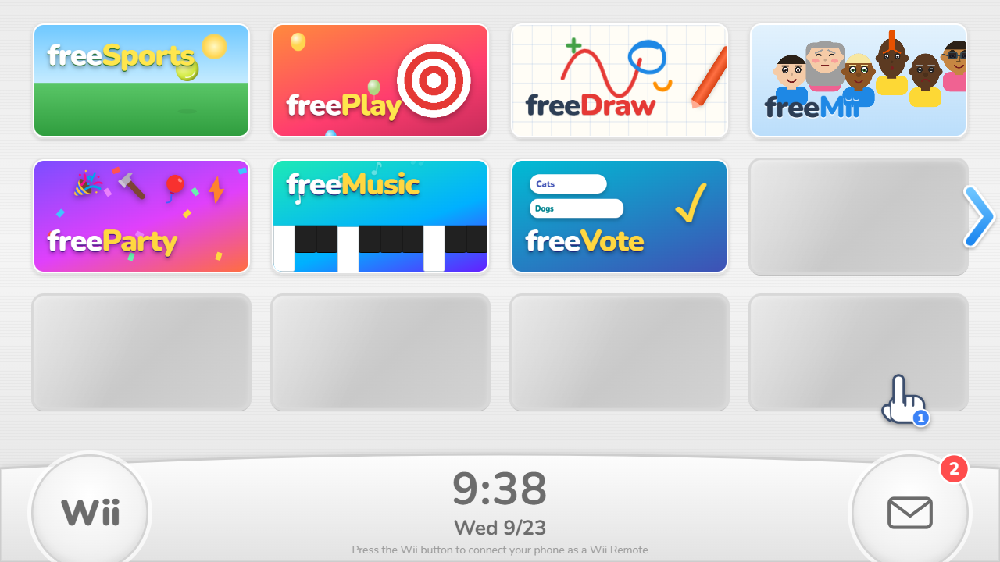
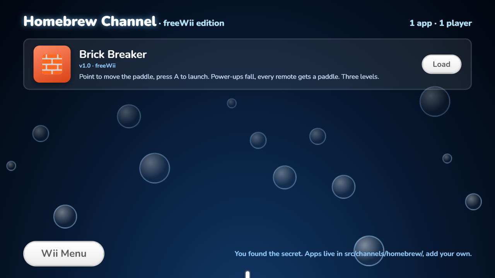
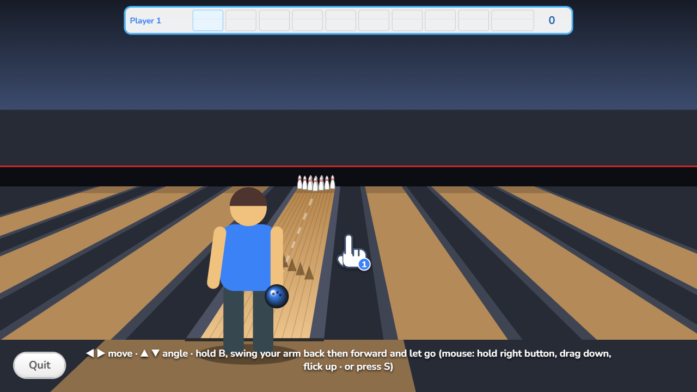
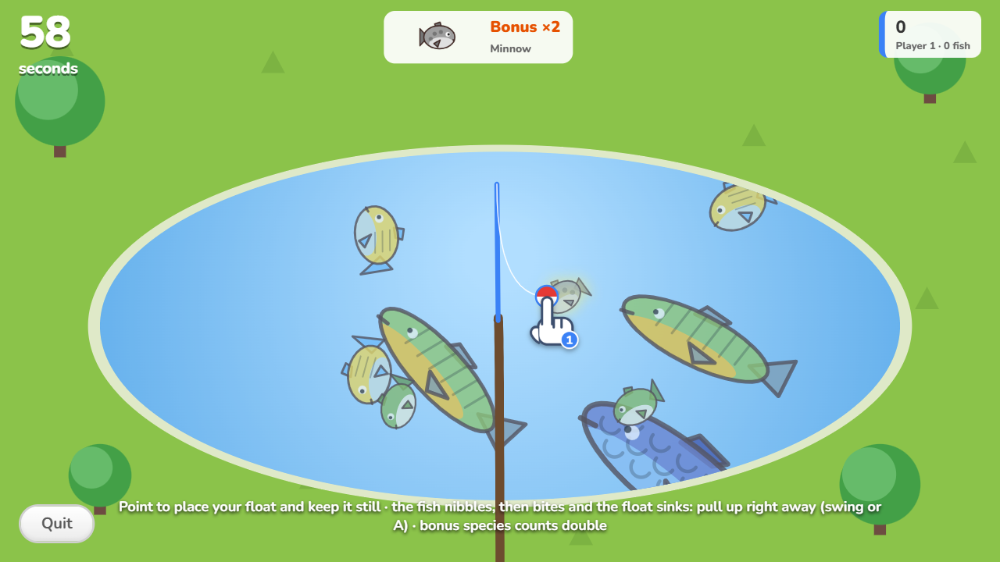
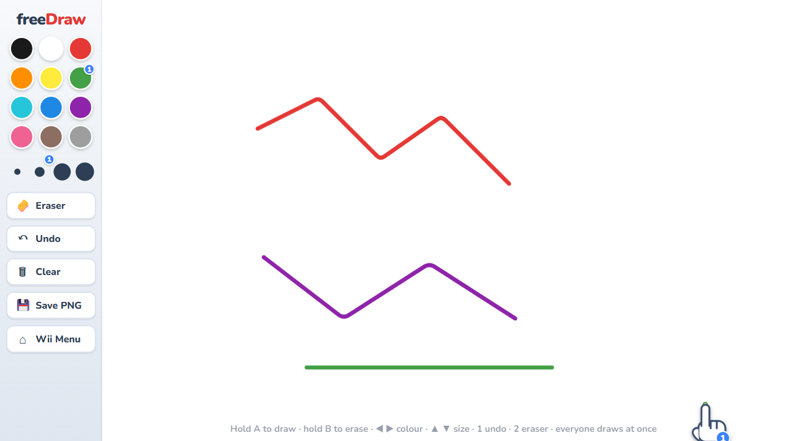
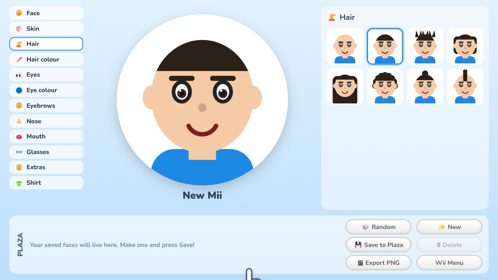
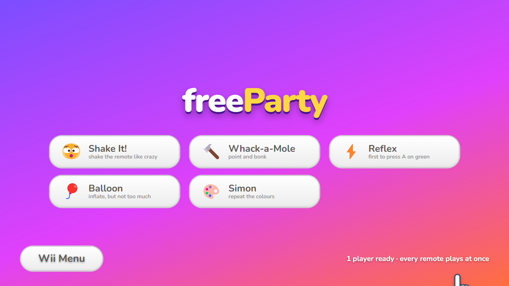
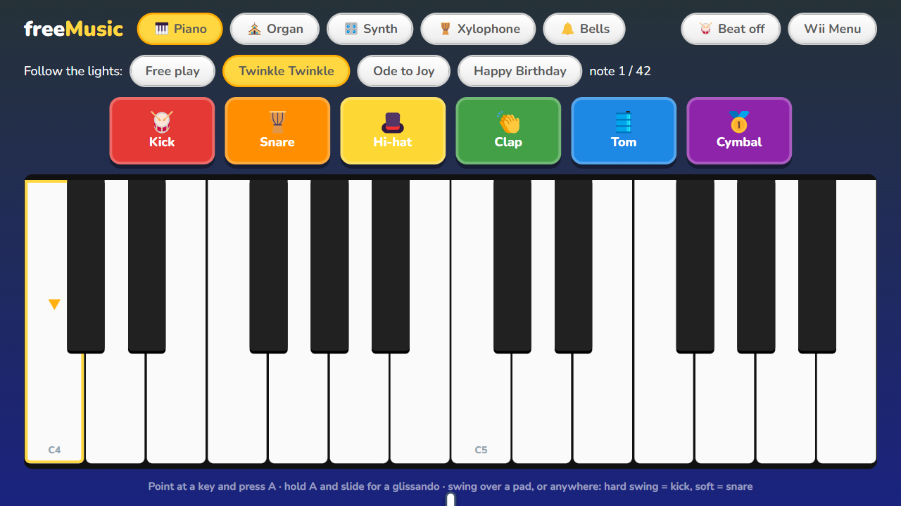
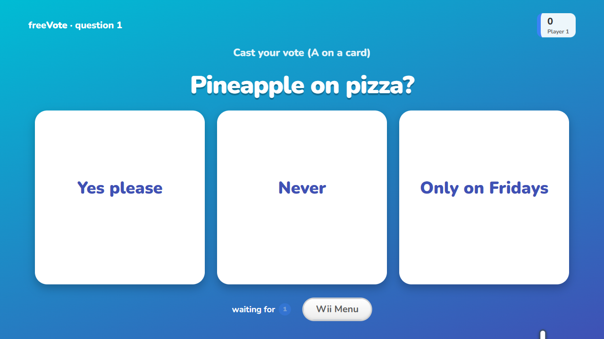
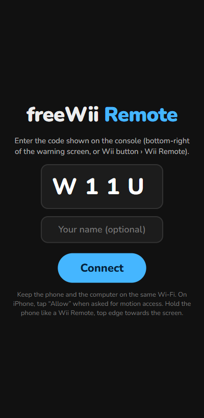

<div align="center">

# freeWii

**An open-source Wii-like console that runs in your browser — and your phone is the Wii Remote.**

[](https://github.com/Lucas-lux/freeWii/actions/workflows/ci.yml)
[](LICENSE)
[](https://vitejs.dev)
[](https://www.typescriptlang.org)
[](#how-the-phone-link-works)



</div>

## What this is

Open the site on your computer, scan a QR code with your phone, and the phone becomes a pointing,
swinging, vibrating remote. The computer shows a Wii Menu with animated channel tiles, a clock, a
message board and a HOME button; the channels are games that anyone can add by dropping a folder
in the repository.

Everything runs in the browser. There is no backend, no account, no telemetry and no database.
The only network traffic is the peer-to-peer link between your phone and your computer.

- 🕹️ **19 games** across 8 channels, from bowling and tennis to whack-a-mole and brick breaker
- 📱 **Up to 4 phones at once**, each with its own cursor, colour and player number
- 🖱️ **Mouse and keyboard fallback**, so the whole console is playable without a phone
- 🔌 **A channel is a folder** — `defineChannel({ id, title, banner, mount })` and you are in the menu
- 🎨 **Zero assets required**: every graphic is drawn procedurally, every sound is synthesized live
- 🚀 **Deploys as a static site** (Vercel, Netlify, GitHub Pages, any bucket)

## Quick start

```bash
git clone https://github.com/Lucas-lux/freeWii.git
cd freeWii
npm install
npm run dev          # http://localhost:5173
```

Then:

1. Open the console on the computer and click once — that is the "Press A" screen, and it unlocks audio.
2. Press the round **Wii** button (bottom-left) › **Wii Remote**.
3. Scan the QR code with your phone, tap **Connect**, and allow motion sensors when asked.
4. Point the phone at the screen and tap **⌖ Centre pointer**. The hand cursor now follows your phone.

> **Phones need HTTPS to expose the gyroscope.** Use `npm run dev:https`, open
> `https://<your-lan-ip>:5173` on both devices and accept the self-signed certificate. Deployed on
> Vercel or any host with TLS, this is automatic.

### Playing without a phone

| Input | Does |
| --- | --- |
| Mouse move | Pointer |
| Left click / `Space` | **A** |
| Right click / `Shift` | **B** |
| `Esc` or `H` | HOME |
| Arrow keys | D-pad |
| `+` `-` `1` `2` | The matching buttons |
| `S`, or a fast mouse flick while holding B | Swing |

## The channels

| Channel | What is inside |
| --- | --- |
| 🎾 **freeSports** | Tennis, Baseball, Bowling, Golf, Boxing |
| 🎯 **freePlay** | Shooting Range, Table Tennis, Pose Mii, Laser Hockey, Billiards, Fishing, Charge!, Tanks! |
| ✏️ **freeDraw** | A shared whiteboard: every remote is a crayon, drawings are kept and export to PNG |
| 🙂 **freeMii** | A face editor with a Plaza that remembers your creations |
| 🎉 **freeParty** | Shake It!, Whack-a-Mole, Reflex, Balloon, Simon — everyone plays at the same time |
| 🎹 **freeMusic** | Two-octave keyboard, five instruments, drum pads, a backing beat, follow-the-lights songs |
| 🗳️ **freeVote** | Vote on silly questions, then guess what the crowd chose |

<details>
<summary><b>There is one more channel.</b> It does not appear in the menu.</summary>

<br>

Someone left a **ticking red letter** on your Wii Message Board (the envelope, bottom-right).
Light the fuse and the **Homebrew Channel** installs itself into the menu, bubbles and all,
carrying a full Brick Breaker with power-ups and one paddle per remote.



It stays unlocked. `window.freewii.relock()` in the browser console hides it again and re-plants the
letter, and any channel can do the same trick with `secret: true` in its definition.

</details>

## Screenshots

| | |
| --- | --- |
|  |  |
|  |  |
|  |  |
|  |  |

Those are captured from a fresh clone, with no media files at all: what you see is what the
repository draws by itself.

## How the phone link works

The computer creates a WebRTC peer whose id is derived from a four-character room code; the phone
dials it. Signaling goes through the public PeerJS cloud by default, and is only used to exchange the
connection offer — after that, sensor data flows peer-to-peer at 50 Hz. Both devices on the same
Wi-Fi is the happy path. To run your own signaling server or add a TURN relay, copy `.env.example`
to `.env`.

The pointer comes from the phone's `deviceorientation` Euler angles, converted into a "where does the
top edge point" vector: yaw and pitch relative to your calibration pose become screen x and y, and
roll tilts the cursor. Swings are peaks in `devicemotion` acceleration, with the direction kept so a
game can tell a forehand from a backhand. Sensitivity and recalibration live in the console settings.

## Adding a channel

A channel is a folder. The registry globs `src/channels/*/channel.{ts,tsx}` at build time, so there
is nothing to register:

```tsx
// src/channels/my-game/channel.tsx
import { defineChannel, reactMount, type BannerProps, type ChannelContext } from '../../core';

function Banner({ active }: BannerProps) {
  // 1cqw = 1% of the tile width, so the banner scales from the menu to full screen
  return <div style={{ position: 'absolute', inset: 0, background: '#4fc3f7', fontSize: '12cqw' }}>My Game</div>;
}

function MyGame({ ctx }: { ctx: ChannelContext }) {
  return <button onClick={() => ctx.exit()}>Back to the Wii Menu</button>;
}

export default defineChannel({ id: 'my-game', title: 'My Game', banner: Banner, mount: reactMount(MyGame) });
```

`mount(ctx)` also accepts plain DOM if you prefer a canvas, Three.js or Phaser. The context hands you
the players' remotes, the audio engine, the message board, `exit()` and a resize callback.
Canvas mini-games can reuse `src/channels/_shared/MiniGame.tsx` for the render loop, the HUD, the
results screen and the Quit button.

Full API: **[`src/channels/README.md`](src/channels/README.md)**.

## Assets

No Nintendo asset ships with this repository, and none ever will. The menu theme, the in-game music
and every sound effect are synthesized live with the Web Audio API; the games are drawn with Canvas
and CSS.

Every one of them is still replaceable: drop a file with the right name into
[`public/assets/`](public/assets/README.md) and the console picks it up at runtime — channel banners
and jingles, system sounds, sprites, backgrounds, music loops. Missing files silently fall back to
the procedural version, so a partial set works fine. Media under `public/assets/` is git-ignored on
purpose: whatever you put there stays on your machine.

## Project layout

```
src/core/            the framework: input (Wiimote, phone link, mouse/keyboard), audio engine,
                     pointer router, channel API, settings, message board, unlocks, runtime
src/console/         the TV: boot screen, Wii Menu, preview, channel runner, HOME menu, panels
src/remote/          the phone page
src/channels/        one folder per channel, auto-registered
src/styles/          global, console and remote stylesheets (--px = 1/1280 of the stage width)
public/assets/       optional media, all of it — see public/assets/README.md
docs/screenshots/    the images in this README
```

## Scripts

| Script | Purpose |
| --- | --- |
| `npm run dev` | Vite dev server |
| `npm run dev:https` | Same, with a self-signed certificate, for testing on a real phone |
| `npm run build` | Type-check, then build to `dist/` |
| `npm run preview` | Serve the production build |
| `npm run typecheck` | TypeScript only |

Handy while developing: `?skipboot=1` lands straight on the Wii Menu, and `window.freewii` exposes
the runtime (`store`, `input`, `audio`, `showToast()`, `unlockChannel()`, `relock()`).

## Deploy

It is a static site: build, then serve `dist/`.

**Vercel** — import the repository, framework preset **Vite**, build `npm run build`, output `dist`.
`vercel.json` rewrites `/remote` to the SPA and sets the `Permissions-Policy` header the phone
sensors need. Nothing else to configure.

**Anywhere else** — serve `dist/`, send `/remote` to `index.html`, and make sure the response carries
`Permissions-Policy: accelerometer=(self), gyroscope=(self)`. HTTPS is mandatory for the gyroscope.

## Contributing

Pull requests are welcome, especially new channels. Read
**[CONTRIBUTING.md](CONTRIBUTING.md)** first — the one hard rule is that no copyrighted asset may
enter the repository.

Ideas that are up for grabs: multiplayer for the sports that are still single-player (baseball,
boxing, pose Mii, charge!, tanks!), a channel gallery, self-hosted signaling, save states for the
message board, and more homebrew apps.

## License

[MIT](LICENSE).

freeWii is a fan project. It is not affiliated with, endorsed by, or connected to Nintendo in any
way. "Wii" and "Wii Remote" are trademarks of Nintendo; this project recreates the *interaction*, not
the content, and ships none of Nintendo's code, art, audio or fonts.
